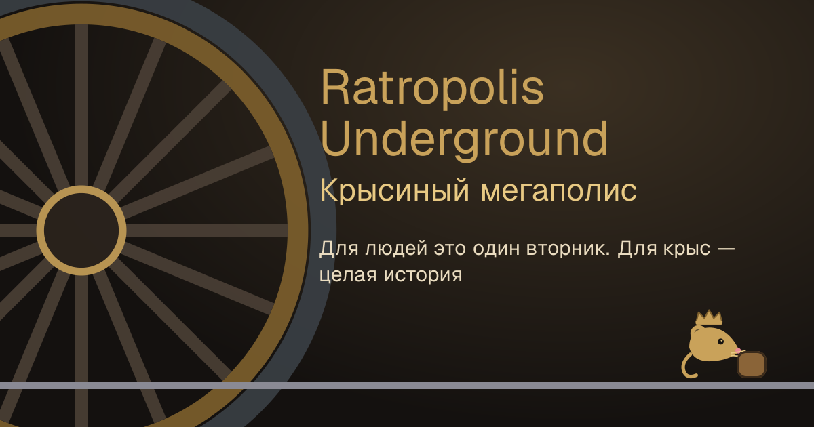
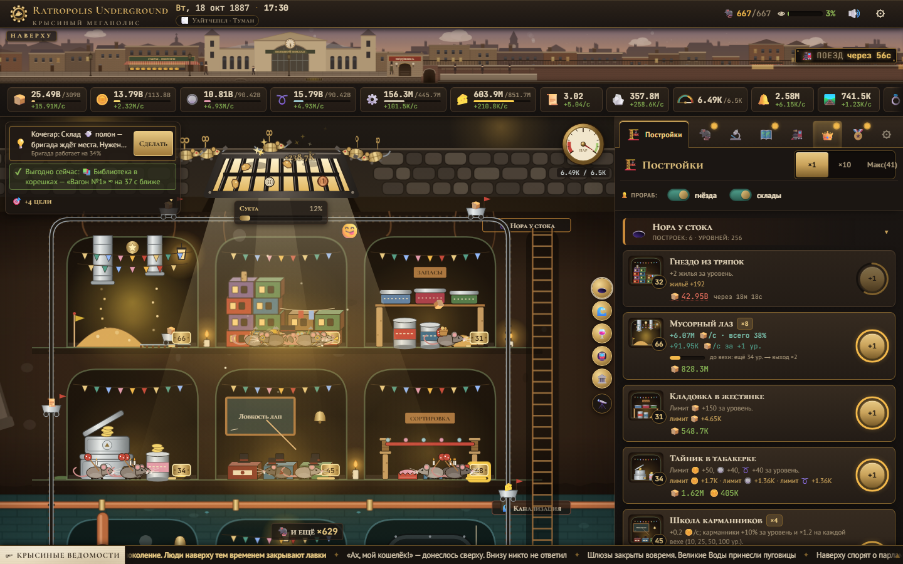
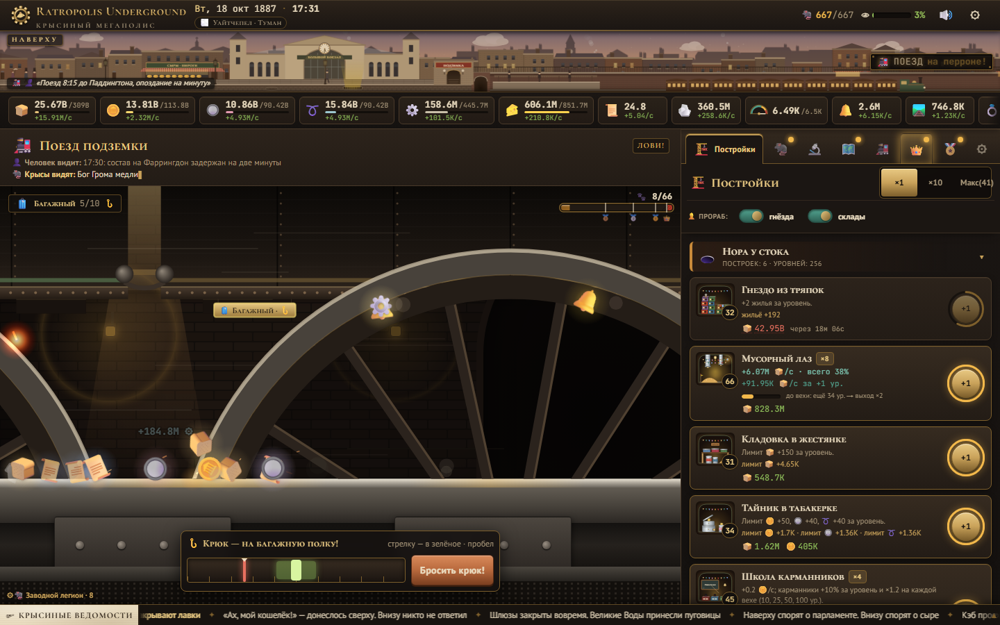
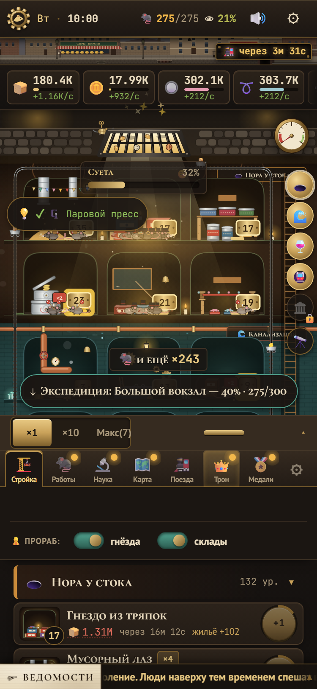

<p align="center">
  
</p>

# Ratropolis Underground | Крысиный мегаполис

[](https://github.com/gvaziro/ratopolis/actions/workflows/ci.yml)
[](https://github.com/gvaziro/ratopolis/actions/workflows/balance.yml)

### [▶ Играть / Play](https://gvaziro.github.io/ratopolis/)

<sub>The play link goes live once GitHub Pages is switched on for the repository (Pages source «GitHub Actions» and the variable `DEPLOY_PAGES=1`, see [Deploy](#деплой--deploy)). Until then: `npm install && npm run dev`.</sub>

**An incremental browser game about a steampunk rat civilisation under Victorian London.**
The world has two scales: up on the street it is one ordinary Tuesday of top hats, cabs and the 8:15; down below, a colony counts every crumb that falls through the gutter grate.
To the humans a train is just a train. To the rats it is an earthquake of steel, and when it has passed, treasure rains from the sky.
Grow from one grate to the Sewers, the Cellars, the Underground and the Grand Terminal, build a locomotive out of thimbles and teapots, crown the Rat King and move the colony across London.

### How to play

- **Click the grate** (or press G / Enter) to drag in crumbs; coins, buttons and wire turn up too.
- **Spend them in the side panel** (a bottom sheet on phones): chambers house and feed the rats, jobs put them to work, upgrades multiply everything.
- **Watch the timetable.** When a train thunders in, hold and sweep across the falling loot (or ← → and Space): every catch in a row grows the combo. Then clear the rubble before the next one.
- **Dig deeper.** Fund expeditions to open new zones; each one rescales the whole colony.
- **Crown the Rat King.** Assemble the Rat Express from scrap, then lead the Great Migration to a new district of London: crowns and royal edicts make the next run faster.

The game is in Russian. It saves in your browser (with backups) and keeps earning for up to 8 hours while you are away.

| Колония / The colony | Поезд метро / A metro train | Телефон / Phone, 375 px |
|---|---|---|
|  |  |  |

## Запуск / Getting started

Нужен Node.js 24 (см. `.nvmrc`; минимум 20.9).

```bash
npm install
npm run dev
```

Откройте http://localhost:3000.

| Команда | Что делает |
|---|---|
| `npm run dev` | дев-сервер Next.js |
| `npm run build` | продакшен-сборка с сервером (Vercel, `npm run start`) |
| `npm run build:static` | статический экспорт в `out/` (GitHub Pages и любой файловый хостинг), см. «Деплой» |
| `npm run check` | типы, линтер и быстрые тесты разом — то же, что проверяет CI |
| `npm test` | быстрые тесты движка (Vitest, без `*.slow.test.ts`, меньше 20 с) |
| `npm run test:slow` | медленные тесты: трёхчасовой прогон бота и другие марафоны (`test:all` — всё сразу) |
| `npm run sim` | headless-симулятор баланса: активный и пассивный боты играют настоящим движком (`-- --seed 777 --strict`) |
| `npm run sim:matrix` | несколько сидов параллельно (`-- --seeds 12345,777,1 --baseline scripts/balance-baseline.json`) |
| `npm run sim:baseline` | записать базовую линию баланса для `sim:matrix --baseline` |
| `npm run e2e` | Playwright: смоук-сценарий и скриншоты на компьютере, 375 px, 320 px и телефоне боком (появится вместе с e2e-набором) |
| `npm run lint` / `npm run typecheck` | ESLint с кэшем / проверка типов (`npm run typegen` создаёт типы маршрутов в свежем клоне) |

## Управление

- **Клик по решётке** — тащить крошки (и иногда находки).
- **Зажать и вести** по падающим предметам во время событий — свайп-сбор, комбо растёт с каждым пойманным подряд.
- **Пробел** — бросить крюк-кошку, когда мимо идёт багажный вагон.
- **Тап по камере** в колонии — подсказка с кнопкой «Построить +1»; кнопки зон слева и 🔭 — быстрый облёт и обзор колонии.
- **💡 Совет старейшины** в «Целях колонии» подсказывает следующий шаг; «Сделать» выполняет его.
- Вкладки справа (на телефоне — снизу, шторку можно развернуть): постройки, работы, улучшения, карта, расписание, переселение, медали, настройки.

### Клавиши

| Клавиша | Действие |
|---|---|
| G или Enter | клик по решётке |
| 1–8 | открыть вкладку по порядку |
| B | режим покупки ×1 → ×10 → Макс |
| Shift / Ctrl + клик по постройке | купить 10 / максимум |
| M | звук вкл/выкл |
| Esc | закрыть рынок, подсказку, всплывающее окно |
| ← → и пробел | ловля во время поезда (пробел — ещё и крюк) |
| Tab и пробел | разбор завалов |
| 1 / 2 | выбор в сценах кота и Крысолова |

## Деплой / Deploy

**Vercel.** Импортируйте репозиторий как проект Next.js — настройки по умолчанию (`npm run build`). Ссылки для превью берутся из `VERCEL_PROJECT_PRODUCTION_URL` сами.

[](https://vercel.com/new/clone?repository-url=https%3A%2F%2Fgithub.com%2Fgvaziro%2Fratopolis)

**GitHub Pages.** Игра целиком клиентская, поэтому собирается в статику:

1. Settings → Pages → Source: **GitHub Actions**.
2. Settings → Secrets and variables → Actions → Variables: `DEPLOY_PAGES` = `1`.
3. Push в `main`: workflow [`pages.yml`](.github/workflows/pages.yml) соберёт `STATIC_EXPORT=1 BASE_PATH=/ratopolis npm run build:static` и выложит `out/` на https://gvaziro.github.io/ratopolis/. Пока переменной нет, workflow пропускается и ничего не ломает.

Локально то же самое: `BASE_PATH=/ratopolis npm run build:static` (в PowerShell — `$env:BASE_PATH="/ratopolis"; npm run build:static`, в Git Bash — с префиксом `MSYS_NO_PATHCONV=1`, иначе он превратит путь в `C:/Program Files/Git/ratopolis`), затем отдайте `out/` любым статическим сервером по адресу `/ratopolis/`. Без `BASE_PATH` сборка рассчитана на корень домена. Переменные: `BASE_PATH` — подпуть сайта, `NEXT_PUBLIC_SITE_URL` — абсолютный адрес для превью ссылок. CI собирает статику на каждом PR, так что сломанный экспорт не доедет до `main`.

## Карта проекта / Project map

Подробно — в [docs/ARCHITECTURE.md](docs/ARCHITECTURE.md) (модули, контракты, правила сохранений).

```
src/
  app/                  оболочка Next.js: layout, манифест, иконки, страница аварии
  game/
    types.ts            контракт типов: id, состояние, эффекты, действия сцен
    data/               таблицы контента: ресурсы, постройки, улучшения, зоны, события, районы, Кунсткамера
    engine/             чистый движок без DOM: шаг, экономика, поезда и события, цели и подсказки, мета, сохранения
    store.ts            Zustand-стор: действия игрока, автосейв, dev-ручка window.__rr
    useGameLoop.ts      цикл 10 Гц, офлайн-прогресс
    fx.ts               шина эффектов между движком и интерфейсом
  components/           React-интерфейс: colony (срез подземелья), panels, scenes (поезда, кот, завалы), modals, layout
  audio/                WebAudio-синтез: эффекты, фон зон, клики
  lib/                  форматирование чисел, телефонная раскладка, «Назад» закрывает окна
scripts/
  balance-sim.ts        симулятор баланса (npm run sim)
  sim-core.ts           боты, которые играют настоящим движком
  sim-matrix.ts         сиды параллельно (npm run sim:matrix)
docs/                   GDD.md (дизайн и цифры), ARCHITECTURE.md, ROADMAP в корне, screenshots/
.github/workflows/      ci.yml (каждый push и PR), balance.yml (ночной баланс), pages.yml (деплой статики)
```

## Что нового в v2

- **Честный темп.** Мягкий потолок венцов, пар без двойного множителя, выплаты разведчиков, пока копишь на экспедицию, бонус работ за вехи ×2. Коронация примерно за 2.5–3 часа, третий забег около 30–40 минут.
- **Поезда с решениями.** Варианты составов метро («Час пик», «Почтовый», «Товарняк», «Подтопленные пути»), сырный вагон, Королевский экспресс, путевой обходчик сметает завалы, шкала улова с медалями 🥉🥈🥇👑, игра с клавиатуры.
- **Мета.** Ранги указов II/III, печати, характер районов, поручения Короля после коронации, 24 новые медали, журнал путейца, летопись забегов и рекорды.
- **Живая колония.** Сапоги и кэбы над улицей, крысы с грузом, «НЕТ ПАРА», стройлеса и «ПАТЕНТ!», силуэт следующей зоны.
- **Телефон и доступность.** Шторка панели, компактный HUD, горячие клавиши, масштаб текста, «Меньше движения» по системной настройке, контраст AA.
- **Надёжность.** Экран аварии со скачиванием сохранения, резервные копии каждые 5 минут и перед импортом или сбросом, карантин повреждённых сохранений, защита от второй вкладки.
- **Звук.** Фон зон (капель, часы, далёкие поезда, гул вокзала) и клики по пентатонике.

## Отладка

Панель разработчика (🛠 у правого края) видна в `npm run dev` или с параметром `?dev` в адресе: ускорение времени, выдача ресурсов, открытие зон, вызов событий. С `?dev` и в продакшен-сборке есть `window.__rr` — стор игры для e2e-тестов и консоли.

## Документы

- [ROADMAP.md](ROADMAP.md) — вехи разработки и статус.
- [docs/GDD.md](docs/GDD.md) — полный дизайн-документ: ресурсы, постройки, улучшения, зоны, события, поезда, престиж, формулы, темп.
- [docs/ARCHITECTURE.md](docs/ARCHITECTURE.md) — устройство кода и контракты модулей.
- [CONTRIBUTING.md](CONTRIBUTING.md) — как проверять изменения, правила данных и сохранений. Нашли ошибку — [заведите issue](https://github.com/gvaziro/ratopolis/issues/new?template=bug.yml) и приложите файл сохранения.

## Технологии

Next.js 16 (App Router), React 19, TypeScript, Tailwind CSS v4, Zustand. Вся графика — SVG, CSS, эмодзи и canvas; все звуки синтезируются WebAudio. Сохранение в localStorage с резервными копиями, офлайн-прогресс до 8 часов. Устанавливается как приложение (манифест и иконки).

## Лицензия

Лицензия пока не выбрана — это решение автора. До тех пор все права на код, тексты и графику принадлежат автору: прежде чем использовать их в своём проекте, спросите в issues.
<sub>No license has been chosen yet; until then all rights are reserved by the author.</sub>
